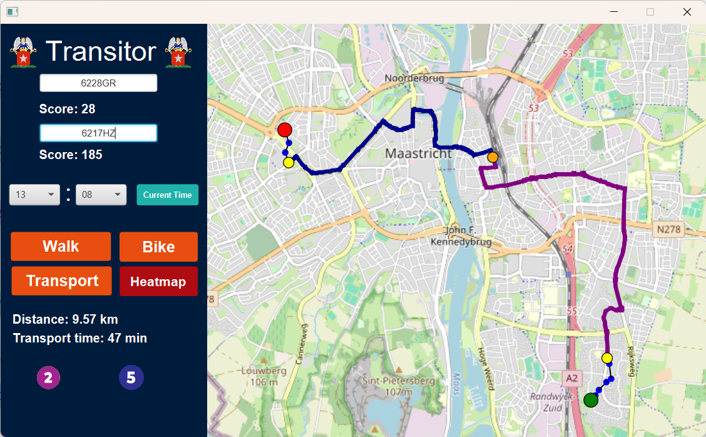

# Transitor

[](https://github.com/sarpery/Transitor/actions/workflows/ci.yml?query=branch%3AvsCode_version)

A JavaFX journey planner and amenity-accessibility explorer for Maastricht, built as a university group project. Compare walking, cycling, and scheduled public-transport journeys between postcodes, then explore the nearby amenities on an interactive map.

## My contribution

I developed most of the JavaFX interface as part of the university project team. My responsibilities included:

- Developing and refining the FXML layout and journey controls, including departure-time selection and the **Current Time** action.
- Connecting route searches to the interface through background JavaFX tasks and managing control states during calculations and input validation.
- Implementing transit-route visualization with bus-line colors, origin, destination and transfer markers, and a bus-number legend.

The routing algorithms, transit data, and accessibility model are part of the team's combined work. Full team credits are below.



## Try it

Install **JDK 17 or newer**, current **Git with Git LFS**, and start **Docker Desktop in Linux-container mode**. On Linux, Docker Engine with Compose v2 also works. The included Maven wrapper downloads the pinned build tools; Unix systems also need `unzip`.

```sh
./mvnw verify
./mvnw javafx:run
```

On Windows, use `mvnw.cmd` instead. In IntelliJ IDEA, open `pom.xml` as a Maven project, select JDK 17 or newer, let dependencies load, then run `com.example.Frontend.UI` or the Maven `javafx:run` goal. A graphical desktop is required.

On launch, Transitor automatically starts its local MariaDB container and prepares the transit data. No database credentials or environment variables are needed for this default setup. The first launch downloads the historical GTFS dump through Git LFS if necessary (approximately **1.1 GB**) and imports it; allow several minutes and several gigabytes of disk space. Later launches reuse the database.

Walking, cycling, and accessibility exploration use the bundled datasets and remain available while transit is preparing or if Docker is unavailable. **Transport** stays disabled until the database and transit graph are ready; its tooltip and the Run console show setup status. Map tiles need an internet connection.

Set `TRANSITOR_DB_AUTO_START=false` to use only the bundled-data features without starting Docker. See [development and database setup](docs/development.md) for startup details, stopping the container, and using an existing database.

## What it does

- Plan walking and cycling routes between Maastricht postcodes.
- Explore scheduled bus journeys, including walking connections and route identifiers.
- Display estimated travel distance and duration for a selected route.
- Visualize amenity-accessibility scores and a city-wide heatmap.
- Choose a departure time for public-transport journeys.

The original JavaFX interface uses an FXML layout with walking, cycling, transit, and heatmap controls. Separate map layers draw routes and accessibility results.

## Project layout

```text
src/main/java/com/example/
  Frontend/                  JavaFX views, controller, and map layers
  Controller/                Connections between the interface and routing logic
  Backend/                   Algorithms, graph models, resource and database access
src/main/resources/
  com/example/Frontend/      FXML and interface image assets
  data/                      Bundled postcode, graph, and amenity datasets
src/test/java/               Automated tests
data/gtfs/                  Historical database dump, stored with Git LFS
compose.yaml                Local transit database service
docs/                      Setup notes, architecture, and screenshots
```

Build output in `target/` and generated local database settings in `.transitor/` are ignored by Git. Dependencies are declared in `pom.xml`; no JAR files need to be copied into the project manually.

See [architecture notes](docs/architecture.md) for how the interface, routing, and data layers fit together.

## Scope and limitations

This is an educational project, not a live travel service. The transit dump dates from **June 2024**; schedules are likely outdated. Walking and cycling summary distances and times are estimates based on the original model, not turn-by-turn navigation or live traffic.

Map backgrounds come from OpenStreetMap.

## Team

Originally developed by university project group 10:

- Ahmed Ahmed Adel Amin Yehia Zakaria Metwally
- Aleksandr Voloshin
- Karol Plandowski
- Kennedy Fernandes
- Khaled Ismail
- Sarper Yüksel
- Ty Barański

This repository retains the group's original work, with subsequent improvements to portability, project organization, and developer setup.

## License

A license for the team's original source code is pending confirmation of contributor permission and any university ownership requirements. No project-wide open-source license has been applied yet.

Dependencies and data have separate terms, including GPLv3 for Gluon Maps and ODbL for the OpenStreetMap GeoJSON data. See [licensing and third-party notices](THIRD_PARTY_NOTICES.md) for the verified terms and remaining provenance questions.
