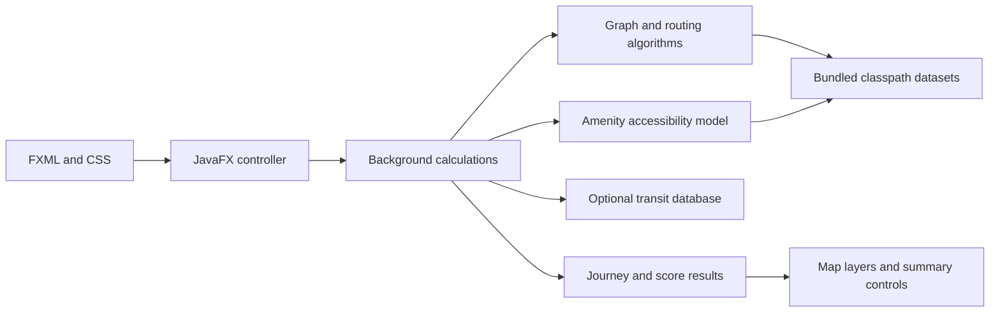

# Architecture

Transitor retains the original group's Java packages and routing model. The maintenance work focuses on a clearer interface, portable resources, explicit database configuration, and a reproducible build.

## Interface

`Frontend/UI` launches the JavaFX application. The FXML describes the layout; CSS controls its appearance. `UIController` coordinates postcode input, travel mode, departure time, route summaries, and accessibility exploration.

Potentially slow calculations run in background tasks. Results and map nodes are applied on the JavaFX application thread. Success, failure, and validation paths should restore the controls so a failed request does not prevent the next journey search.

The map layers render route or accessibility results. Bus routes use text and color identifiers instead of one image asset per route number.

## Routing and accessibility

`Backend/Graph` contains the adjacency-list graph and trip models. `Backend/Algorithms` contains the group's Dijkstra, A*, bus-routing, and amenity-accessibility calculations. `Controller` provides the existing connections between those algorithms and the frontend.

The accessibility model combines distance decay with weights for amenity categories. The interface presents these values as model scores, with a legend for the heatmap. The numerical model remains the group's work; the presentation does not imply a validated real-world index.

## Data boundaries

Small, required datasets live in `src/main/resources/data` and load from the classpath. Resource loading also supports filesystem paths for existing tests and development inputs. Application startup therefore does not depend on the shell's working directory.

The optional GTFS database is configured at runtime. Connection settings are centralized, rather than repeated as credentials in source files. If transit is unconfigured or unavailable, the frontend explains that state while keeping the bundled-data features available.

The large SQL dump lives separately under `data/gtfs` and is tracked using Git LFS. It is not packaged into the application JAR.

## Verification

`./mvnw verify` compiles the application and runs JUnit tests for the graph and algorithms, plus focused regressions for resource loading, configuration, and frontend input handling. GitHub Actions runs the same command on Java 17.

GUI verification is separate: launch the real FXML, try the example route, check its summary and overlay, submit invalid and disconnected postcodes, and confirm that subsequent requests remain usable. Database-enabled and database-free launches exercise different startup paths.
