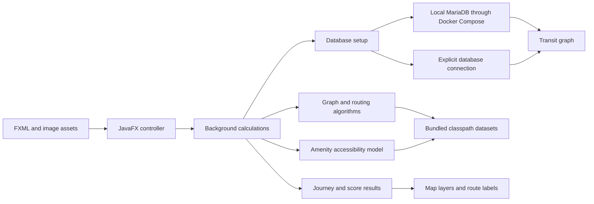

# Architecture

Transitor retains the original group's Java packages and routing model. The maintenance work focuses on portable resources, automatic local database setup with explicit connection overrides, and a reproducible build while keeping the original JavaFX interface.

## Interface

`Frontend/UI` launches the JavaFX application. The FXML describes the original layout and styling. `UIController` connects the postcode inputs, Walk/Bike/Transport buttons, departure-time selectors, route labels, and heatmap controls.

Route and heatmap actions use JavaFX tasks. The controller updates distance and travel-time labels and adds the corresponding map layers.

The map layers render route or accessibility results. The transit display uses the original route-number image assets.

## Routing and accessibility

`Backend/Graph` contains the adjacency-list graph and trip models. `Backend/Algorithms` contains the group's Dijkstra, A*, bus-routing, and amenity-accessibility calculations. `Controller` provides the existing connections between those algorithms and the frontend.

The accessibility model combines distance decay with weights for amenity categories. The interface displays these values as scores and a heatmap. The numerical model remains the group's work; the presentation does not imply a validated real-world index.

## Data boundaries

Small, required datasets live in `src/main/resources/data` and load from the classpath. Resource loading also supports filesystem paths for existing tests and development inputs. Application startup therefore does not depend on the shell's working directory.

`DatabaseConfig` centralizes database settings. Explicit connection settings take precedence; partial manual settings report an error. With no manual settings, the application prepares the local MariaDB service through Docker Compose unless automatic startup is disabled.

Preparation runs as part of the background database task. It finds the project, fetches the Git LFS dump if needed, starts the service, imports the transit data, and loads the graph. The original Transport button remains disabled until this completes; its tooltip and the application console report status. Walking, cycling, and accessibility calculations continue to use bundled datasets.

The Docker service uses a loopback port, generated credentials in ignored `.transitor/docker.env`, and a persistent volume. Its Compose project name is derived from the checkout path. Later launches reuse the database. `TRANSITOR_PROJECT_DIR` can identify the checkout for custom launch locations, and `TRANSITOR_DB_AUTO_START=false` disables automatic provisioning. An existing server can be selected through the manual connection settings instead.

The large SQL dump lives separately under `data/gtfs` and is tracked using Git LFS. It is not packaged into the application JAR.

## Verification

`./mvnw verify` compiles the application and runs JUnit tests for the graph and algorithms, plus focused regressions for resource loading, database configuration, and postcode input validation. GitHub Actions runs the same command on Java 17.

GUI verification is separate: launch the FXML, enter a known postcode pair such as 6211AB to 6211AS, click Walk or Bike, and check the distance/time labels and map overlay. Check the heatmap separately, and test Transport with the local database configured. Automatic Docker startup, explicit database settings, and an automatic-start opt-out exercise different startup paths. First-import and existing-volume runs should be checked separately when validating the Docker integration.
